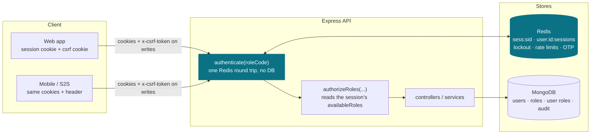
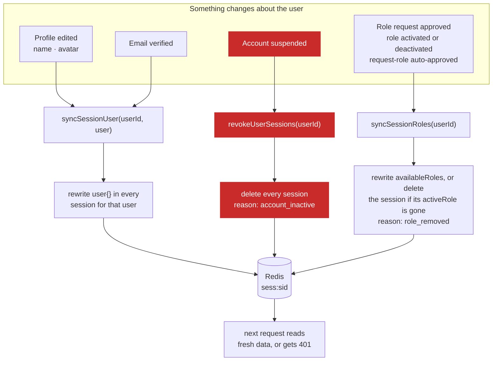

# Auth module

> **Verified against the code on 2026-10-19** (branch `fix/code-audit-and-deps`). Built: Redis
> sessions, lockout, CSRF, the Google provider, OTP flows and the audit log. **Target design — not
> built:** permissions as database rows ([authorization.md](authorization.md)) and the Postgres schema
> ([data-model.md](data-model.md)). Each page says which it is. No production build has been run.

**One-line summary:** an opaque session token in an httpOnly per-portal cookie, hashed at rest in
Redis, one entry per device. Authenticating a request costs one Redis round trip and no database
call; revoking a session deletes it.

**There is no JWT and no refresh token.** A JWT that still needs a server-side lookup adds crypto to
every request and buys nothing, so the layer was dropped; opaque sessions revoke instantly on their
own. The reasoning and sources are in [../../decisions.md](../../decisions.md).

| Document | Covers | Status |
|---|---|---|
| [flows.md](flows.md) | login, the hot path, revocation, lockout, CSRF | **built** |
| [security.md](security.md) | the hardening requirements | mixed — marked per section |
| [data-model.md](data-model.md) | Postgres schema; cookies as built | target design, plus one built section |
| [authorization.md](authorization.md) | permissions as data, `own`/`tenant`/`any` scope | target design — not built |
| [legacy-migration.md](legacy-migration.md) | what the inherited code did, and why it was replaced | historical |

---

## The big picture



**The load-bearing idea:** the highlighted path is the hot path, and it touches **Redis only**.
Authenticating a request costs one Redis round trip (GET + TTL in one MULTI on the session key) and
no database call. It writes only when less than half the session TTL remains: an EXPIRE on the
session key and its user index, fire-and-forget. Details and citations: [flows.md §2](flows.md#2-authenticated-request--the-hot-path).

Services today call Mongoose models directly. `models/<X>/repo.ts` for every entity is the target
design — today only the Redis-backed `models/Session/` has a `repo.ts`.

### What that costs, and how the cost is paid

The session record carries the display fields `req.user` promises, so the middleware never loads the
user. A copy can go stale, so every write that changes one either **rewrites** the copy or
**destroys** the session:



**The red path is the security-critical one.** `authenticate` does not check `user.status`, so
revocation on suspension is the only thing that ends a suspended account's access
(`auth/index.ts:27-28`, `user/controllers/admin/managedUser.ts:250-255`).

**Roles are cached the same way.** `authorizeRoles` reads the session's `availableRoles`, copied in
at login (`authenticate.ts:57-60`). The actions that change which roles a user holds — an admin
approving a role request, an admin activating or deactivating a role, and an auto-approved
`POST /request-role` — rewrite `availableRoles` in every live session of the user, or delete a
session whose `activeRole` the user no longer holds (`syncSessionRoles`, `auth/index.ts:33-34`;
`session.service.ts:269-283`; the request-role path calls `syncRoles` itself,
`auth.service.ts:258-262`). A role change made any other way, such as by hand in MongoDB, reaches a
device only at its next login. Full
detail: [flows.md — What the session copy does decide](flows.md#what-the-session-copy-does-decide-roles).

---

## API surface

Mounted at `/api/v1/<portal>/auth/...` (`auth/index.ts:36-41`). Portals: `admin`, `vendor`,
`associate`, `customer` (`cookieHelper.ts:6-11`). Each portal has its own router, so
**availability differs** — read from `routes/<portal>/auth.ts`.

A ✅ in CSRF means the route needs the `x-csrf-token` header, from browsers and mobile clients alike
unless `CSRF_ENABLED=false` ([flows.md — Where CSRF fits](flows.md#where-csrf-fits)).

| Endpoint | admin | vendor | associate | customer | CSRF | Notes |
|---|:-:|:-:|:-:|:-:|:-:|---|
| `POST /register` | — | ✓ | ✓ | ✓ | — | Gated by `role.canSelfRegister`; password policy applies; same body whether or not the email exists (`auth.service.ts:60-109`). 201, `message` at top level, `data: { user, role, requiresEmailVerification }` |
| `POST /login` | ✓ | ✓ | ✓ | ✓ | — | Sets the cookies; `data: { user, csrfToken }`, or `{ requiresEmailVerification, email }` with no cookie ([flows.md §1](flows.md#1-login)). Any held role that maps to the portal is accepted, so a SUPER_ADMIN-only user logs in to `admin` as SUPER_ADMIN (`auth.service.ts:163-166`); same for `/oauth/:provider` |
| `POST /oauth/:provider` | ✓ | ✓ | ✓ | ✓ | — | Only `google` is registered (`providers/registry.ts:4-6`). Unknown or disabled → 404 `PROVIDER_NOT_AVAILABLE`. `data: { user, isNewUser, csrfToken }` |
| `POST /logout` | ✓ | ✓ | ✓ | ✓ | ✅ | Deletes this session. `message` at top level, no `data` (`portalAuth.ts:48-63`) |
| `POST /logout-all` | ✓ | ✓ | ✓ | ✓ | ✅ | Deletes every session for the user. `message` at top level, no `data` |
| `GET /me` | ✓ | ✓ | ✓ | ✓ | — | `data: { user }`, from `req.user` |
| `GET /sessions` | ✓ | ✓ | ✓ | ✓ | — | `data: { sessions }` — this user's devices |
| `DELETE /sessions/:sid` | ✓ | ✓ | ✓ | ✓ | ✅ | Revoke one device; 404 if not the caller's. `message` at top level, `data: { sid }` |
| `POST /switch-role` | ✓ | ✓ | ✓ | — | ✅ | Sets `activeRole` to a code in the session's `availableRoles`; `data: { activeRole }` |
| `GET /roles` | — | ✓ | ✓ | — | — | Approved roles read from MongoDB; `data: { roles }` |
| `POST /request-role` | — | ✓ | ✓ | — | ✅ | Creates a user role for a `canSelfRegister` role. `PENDING`, unless that role has `autoApproveOnSignup` (`UserRole/schema.ts:107-112`). An auto-approved role is written into the caller's live sessions at once, no new login needed (`auth.service.ts:258-262`). An admin approves or rejects a `PENDING` request at `/admin/role-requests` in the user module ([../README.md](../README.md#not-documented-yet)). `message` at top level — `Role granted.` if approved, otherwise `Request submitted. Awaiting admin approval.` (`portalAuth.ts:93-96`) — and `data: { role }` |
| `POST /verify-email` · `POST /send-otp` | — | ✓ | ✓ | ✓ | — | Same response whether or not the account exists |
| `POST /forgot-password` · `POST /verify-otp` · `POST /reset-password` | ✓ | ✓ | ✓ | ✓ | — | Reset clears the lockout and revokes every session (`passwordReset.ts:140-141`) |
| `GET /referral-code` | — | ✓ | ✓ | — | — | Served by the **referral** module at this URL (`referral/index.ts:15-16`), not by auth |

Handlers: `controllers/<portal>/index.ts` builds `register`, `login`, `logout`, `logoutAll`,
`getMe`, `switchRole`, `getAvailableRoles`, `requestRole` and `socialLogin` from
`createPortalAuthController` (`portalAuth.ts:11-110`), and re-exports `forgotPassword`,
`verifyResetOtp`, `resetPassword`, `verifyEmailOtp`, `sendEmailOtp`, `listSessions` and
`revokeSessionById` from `controllers/shared/`.

**No `/refresh`.** There is no refresh token — see [../../decisions.md](../../decisions.md).

---

## Where the code lives

```
src/
├─ config/env.ts                     # fail-fast secrets, readInt-validated numbers
├─ middlewares/rateLimit.ts          # own Redis limiter (global + per route)
├─ modules/auth/
│  ├─ index.ts                       # front door: register, authenticate, authorizeRoles, verifyCsrf, …
│  ├─ signupHooks.ts                 # setSignupHook, setRoleApprovedHook — how a product module joins in
│  ├─ middlewares/
│  │  ├─ authenticate.ts             # authenticate(roleCode) + authorizeRoles
│  │  └─ csrf.ts                     # session-bound double-submit
│  ├─ services/
│  │  ├─ auth.service.ts             # register, login (portal-role pick), logout-all, switch / request role
│  │  ├─ session.service.ts          # create / verify / revoke / list devices, user + role sync, reset sessions
│  │  ├─ password.service.ts         # credential check, hashing, policy + HIBP
│  │  ├─ lockout.service.ts          # per-account counters in Redis
│  │  └─ identity.service.ts         # provider identity → find / link / create user
│  ├─ providers/{google,registry,types,index}.ts
│  ├─ helpers/otp.ts                 # generateOtp, storeOtp, verifyOtp, clearOtpKeys
│  ├─ models/Session/{index,types,repo}.ts
│  ├─ validators/index.ts            # zod schemas
│  ├─ controllers/{admin,vendor,associate,customer}/ + shared/
│  └─ routes/<portal>/auth.ts + routes/shared/limits.ts
├─ modules/audit/                    # AuditLog model + record()
├─ modules/user/models/{User,Role,UserRole}/
└─ utils/{cookieHelper,redisKeys}.ts # portal map + cookies; every Redis key builder
```

**Front door** (`auth/index.ts:43-58`): `register`, `registerUser`, `hashPassword`,
`assertPasswordAllowed`, `revokeUserSessions`, `syncSessionUser`, `syncSessionRoles`, `authenticate`,
`authorizeRoles`, `verifyCsrf`, `setSignupHook`, `setRoleApprovedHook`, `runRoleApprovedHook`, and
the `SignupHook` and `RoleApprovedHook` types.

**Hooks.** Auth knows nothing about referrals. The referral module registers two hooks on itself
(`referral/index.ts:10-11`, implemented in `referral/signupHook.ts`); auth only stores and runs
them (`signupHooks.ts:17-43`).

- **Signup hook.** Auth runs it before creating the user, so a rejected referral code leaves
  nothing behind, and calls the function it returns once the role is assigned
  (`auth.service.ts:71,126,250,257`). Referral's version records a `PENDING` referral when a code
  was given (`referral/signupHook.ts:16-34`).
- **Role-approved hook.** Runs on every path that leaves a role `APPROVED`: auto-approval in
  `register` and `requestRole` (`auth.service.ts:127-129,258-259`), an admin approving a request
  (`user/controllers/admin/roleRequest.ts:71`), and an admin creating a user
  (`user/controllers/admin/managedUser.ts:205`). Referral's version activates that user's `PENDING`
  referral for the role (`ACTIVE`, `activatedAt`, +1 `successfulReferrals` on the code) and gives a
  BUSINESS_ASSOCIATE or VENDOR a referral code if they have none (`referral/signupHook.ts:36-52`).

> **Real world:** in production Nadia signs up as a vendor with Ali's referral code. VENDOR needs
> admin approval there (`autoApproveOnSignup: !IN_PROD`, `user/seed/roles.ts:36`), so the referral
> is stored as `PENDING`. When an admin approves her request, the hook marks
> it `ACTIVE`, adds one to Ali's successful referrals, and creates Nadia's own referral code.

Delete the referral module and registration still works — neither hook is set, and running an
unset hook does nothing (`signupHooks.ts:36,38-40`).

**Target design — not built**, named so nobody hunts for them: `config/prisma.ts`,
`middlewares/authorize.ts` (`requirePermission`), `seed/permissions.ts`, `req.actor`, the `prisma/`
schema, and `models/<X>/repo.ts` for the Mongo entities. Models are Mongoose `schema.ts` today.

**The reuse test** (not yet achievable — roles are still a `ROLE_CODE` enum,
`user/models/Role/types.ts:10-16`): onboarding a client should touch `seed/roles.ts`,
`seed/permissions.ts` and `.env`, nothing else. If adding a role means opening a controller, the
design has drifted.
