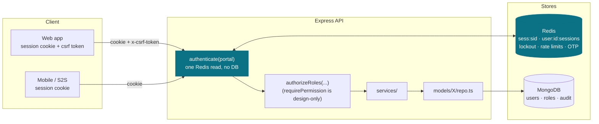
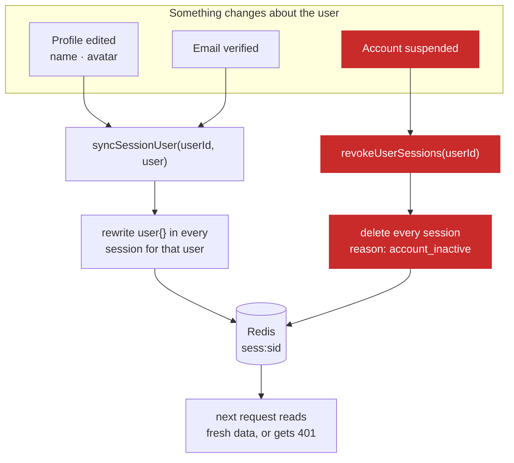

# Auth module

> **Runtime-verified 2026-09-01** against live Mongo + Redis — see [flows.md](flows.md) for exactly
> which paths were exercised and which were not. No production build has been run.
> Session handling, lockout, CSRF, providers and the audit log all exist in `src/`.
> Still design-only: RBAC permissions as database rows (`authorization.md`), and the Postgres
> schema in `data-model.md`. Each page says which it is.

**One-line summary:** an opaque session token in an httpOnly per-portal cookie, hashed at rest in
Redis, one entry per device — verified in **one Redis read with no writes**, revoked by deleting it.

**There is no JWT and no refresh token.** A JWT that still needs a server-side lookup adds crypto to
every request and buys nothing, so the layer was dropped; opaque sessions revoke instantly on their
own. The reasoning and sources are in [../../decisions.md](../../decisions.md).

| Document | Covers | Status |
|---|---|---|
| [flows.md](flows.md) | login, the hot path, revocation, lockout | **built** |
| [security.md](security.md) | the hardening requirements | mixed — see the page |
| [data-model.md](data-model.md) | Postgres schema, Redis keys, cookies | design |
| [authorization.md](authorization.md) | permissions as data, `own`/`tenant`/`any` scope | design |
| [legacy-migration.md](legacy-migration.md) | what the inherited code did, and why | historical |

---

## The big picture



**The load-bearing idea:** the highlighted path is the hot path, and it touches **Redis only**.
An authenticated request performs **one Redis read and zero writes**, and makes **no database call
at all**. Everything else in these documents exists to keep that true while still allowing instant
revocation.

### What that costs, and how the cost is paid

The session record carries the display fields `req.user` promises, so the middleware never loads the
user. A copy can go stale, so every write that changes one either **rewrites** the copy or
**destroys** the session:



**The red path is the security-critical one.** `authenticate` no longer checks `user.status`, so
revocation on suspension is the only thing that ends a suspended account's access. Miss it and a
suspended user keeps working sessions until they expire — up to 30 days.

Nothing cached in the session grants access by itself: authorization reads `availableRoles`, written
at login and rewritten by `switchActiveRole`.

---

## API surface

Per portal, at `/api/v1/<portal>/auth/...`. Which routes exist is driven by role config —
`canSelfRegister`, `autoApproveOnSignup`, `emailVerificationRequired`.

A ✅ needs the `x-csrf-token` header; the rest are reachable before a token exists and cannot
require one.

| Endpoint | CSRF | Notes |
|---|---|---|
| `POST /register` | — | gated by `role.canSelfRegister`; same response whether or not the email exists; password policy applies |
| `POST /login` | — | argon2id verify (bcrypt for legacy, upgraded on success) + Redis lockout → session cookie + `csrfToken` |
| `POST /oauth/:provider` | — | Google today. `password` is rejected here: `/login` is the only credential path |
| `POST /logout` | ✅ | deletes this session |
| `POST /logout-all` | ✅ | deletes every session for the user |
| `GET /me` | — | from `req.user` |
| `GET /sessions` | — | list this user's devices |
| `DELETE /sessions/:sid` | ✅ | revoke one device; ownership checked in one Redis read |
| `POST /switch-role` | ✅ | rewrites `activeRole` on the session record |
| `POST /request-role` | ✅ | keeps the approve/reject/suspend/revoke lifecycle |
| `POST /verify-email` · `POST /send-otp` | — | identical responses regardless of account existence |
| `POST /forgot-password` · `POST /verify-otp` · `POST /reset-password` | — | reset clears the lockout and revokes every session |

**No `/refresh`.** There is no refresh token — see [../../decisions.md](../../decisions.md).

Dropped from the inherited codebase: `GET /referral-code` — product-specific, belongs to a business module.

---

## Where the code lives

What exists today:

```
src/
├─ config/env.ts                    # fail-fast secrets, readInt-validated numbers
├─ middlewares/
│  ├─ authenticate.ts               # one Redis read, no writes
│  ├─ rateLimit.ts                  # own Redis limiter, pipelined
│  └─ csrf.ts                       # stateless double-submit
├─ modules/auth/
│  ├─ services/
│  │  ├─ session.service.ts         # create / verify / revoke / list devices
│  │  ├─ password.service.ts        # credential check + policy + HIBP
│  │  ├─ lockout.service.ts         # per-account counters in Redis
│  │  └─ identity.service.ts        # find / link / create, one funnel per provider
│  ├─ providers/{password,google,registry}.ts
│  ├─ models/Session/{index,types,repo}.ts
│  ├─ controllers/{admin,vendor,associate,customer}/ + shared/
│  └─ routes/<portal>/auth.ts + routes/shared/limits.ts
├─ modules/audit/                   # AuditLog model + record()
├─ modules/user/models/{User,Role,UserRole}/
└─ utils/{cookieHelper,redisKeys,otp}.ts
```

Not built, and named here only so nobody hunts for them: `config/prisma.ts`, `config/portals.ts`,
`middlewares/authorize.ts` (`requirePermission`), `seed/permissions.ts`, `req.actor`, and the
`prisma/` schema. Models are Mongoose `schema.ts`, not Prisma `repo.ts`.

**The reuse test** (not yet achievable — roles are still a `ROLE_CODE` enum): onboarding a client
should touch `seed/roles.ts`, `seed/permissions.ts` and `.env`, nothing else. If adding a role means
opening a controller, the design has drifted.
