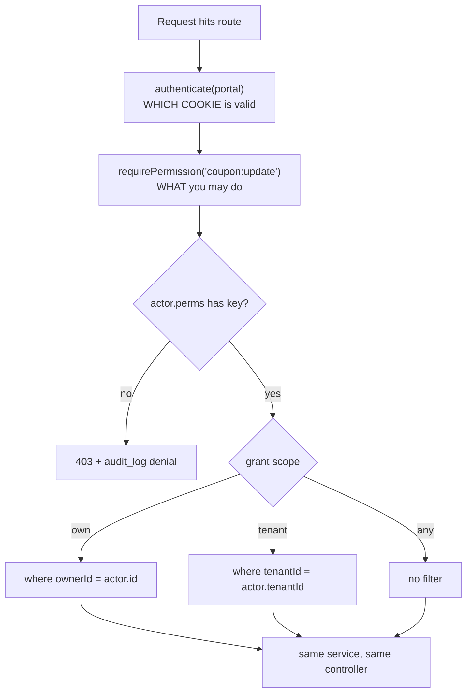

# Auth — authorization

> **Target design — not built yet.** Nothing on this page exists in `src/` today; it is checked for
> internal consistency, not against code. **Today** (verified 2026-10-19): roles are the `ROLE_CODE`
> enum (`user/models/Role/types.ts:10-16`), and `authorizeRoles(...)` passes if the session's
> `availableRoles` snapshot holds any listed role, whatever `activeRole` is
> (`auth/middlewares/authenticate.ts:57-72`). How that runs: [flows.md](flows.md) and
> [../../platform/redis.md](../../platform/redis.md).

Permissions are **rows in the database**, not a TypeScript enum. This is the single decision that
makes the starter reusable: a new client role is a seed row, not a code change and a redeploy.

Permission keys are `resource:action`. The **scope** lives on the `role_permissions` row, not in
the key, and it narrows the query automatically.



## The guard and the scope resolver

```ts
// middlewares/authorize.ts
const requirePermission = (key: string) => (req, _res, next) => {
  const actor = req.actor;                          // set by authenticate()
  const grant = actor.perms[key];                   // "own" | "tenant" | "any" | undefined
  if (!grant) return next(ApiError.forbidden('Insufficient permissions', 'PERM_DENIED'));
  req.scope = grant;                                // services read this
  next();
};

// used by every service that lists or updates a resource
const scopeWhere = (actor, scope, ownerField = 'userId') => {
  if (scope === 'any')    return {};
  if (scope === 'tenant') return { tenantId: actor.tenantId };
  return { [ownerField]: actor.id };                // "own"
};
```

```ts
// routes — identical service for every audience, no duplicated controllers
router.get('/',      requirePermission('coupon:read'),   ctrl.list);
router.patch('/:id', requirePermission('coupon:update'), ctrl.update);
```

`authenticate(portal)` and `requirePermission(key)` are **different axes** and both stay: the first
decides which cookie is acceptable, the second decides what the actor may do. `requirePermission`
replaces `authorizeRoles` entirely — see [legacy-migration.md](legacy-migration.md).

**This is what removes the duplicated admin / vendor / customer controllers.** Same service,
different scope.

## Seeds — this is what makes a new client cheap

```ts
// modules/user/seed/permissions.ts   — the catalog (code)
export const PERMISSIONS = [
  'user:read', 'user:update', 'user:approve', 'user:suspend',
  'role:read', 'role:create', 'role:update', 'role:assign',
  'audit:read',
] as const;

// modules/user/seed/roles.ts         — per-project data
export const ROLES = [
  { code: 'SUPER_ADMIN', name: 'Super Admin', isSystem: true,
    permissions: [['*', 'any']] },
  { code: 'ADMIN', name: 'Admin', isSystem: true,
    permissions: [['user:read','tenant'], ['user:approve','tenant'], ['role:read','tenant']] },
  { code: 'CUSTOMER', name: 'Customer', canSelfRegister: true, autoApproveOnSignup: true,
    permissions: [['user:read','own'], ['user:update','own']] },
];
```

**A new client requirement = edit this array and rerun the seed.** "Regional manager who can
approve vendors in their region but not issue refunds" is rows in `roles` + `role_permissions`.
Zero code, zero redeploy.

If a future change ever requires touching a controller to add a role, the design has drifted and
must be pulled back.

## Swapping the model later

`requirePermission()` is the seam. RBAC + scope covers roughly 95% of client requirements without
running an extra service. If a client genuinely needs full ReBAC (OpenFGA, SpiceDB), it goes behind
the same call sites — no route or service changes.
