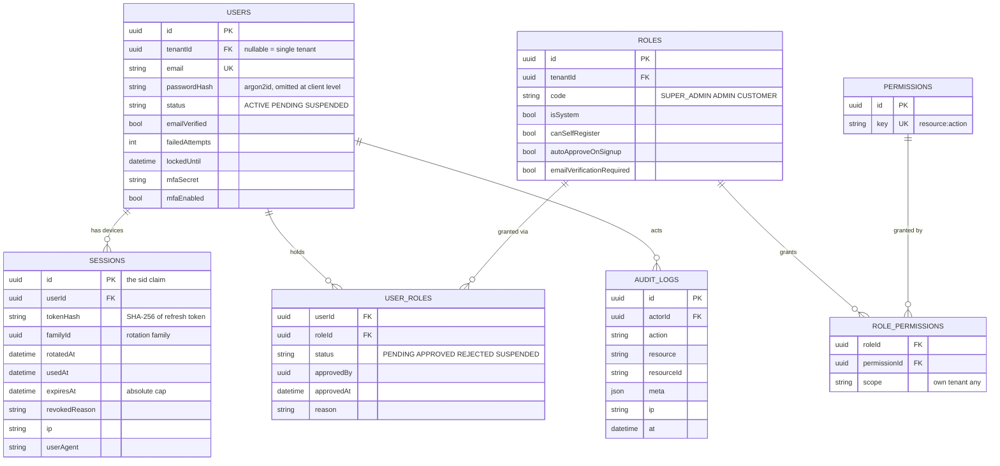

# Auth — data model

> **Target design — not built yet.** Nothing on this page exists in `src/` today; it is checked for internal consistency, not against code. For what the code actually does now, see [legacy-migration.md](legacy-migration.md).

Seven tables, deliberately minimal. See [../../decisions.md](../../decisions.md) for why `tenants` and MFA
are columns rather than tables.

Notes worth internalising:

- `sessions` is **one row per device**, and the row *is* the token family — that is what makes
  reuse detection work without a second table.
- The refresh token is stored as a **SHA-256 hash**. Plaintext exists only inside the cookie. A
  database dump must never equal account takeover.
- Roles and permissions are **rows, not TypeScript enums**. A new client role is a seed row.
- One `.prisma` file per module: `prisma/models/{user,auth,rbac,audit}.prisma`.

---

## Tokens and cookies — as built

There is one token: an opaque `<sid>.<secret>` in an httpOnly, Secure, SameSite cookie, named per
portal (`<base>_admin`, `<base>_vendor`, `<base>_associate`, `<base>_customer`).
Redis stores only `SHA-256(secret)`. A separate `<base>_reset` cookie holds a password-reset id
between `/verify-otp` and `/reset-password`; it is not a session and is outside the portal map
(`utils/cookieHelper.ts:14,46-52`). That per-portal split is why an admin cookie cannot be replayed
against the customer API — it should become env-driven rather than keyed off the role enum.

A second, deliberately **readable** cookie carries the CSRF token, which the client echoes in
`x-csrf-token`.

No JWT, no refresh token, no `kid` key map — see [../../decisions.md](../../decisions.md).

## Redis keys

Documented once, in [../../platform/redis.md](../../platform/redis.md). Repeating the key map here
would leave two versions to drift apart.
