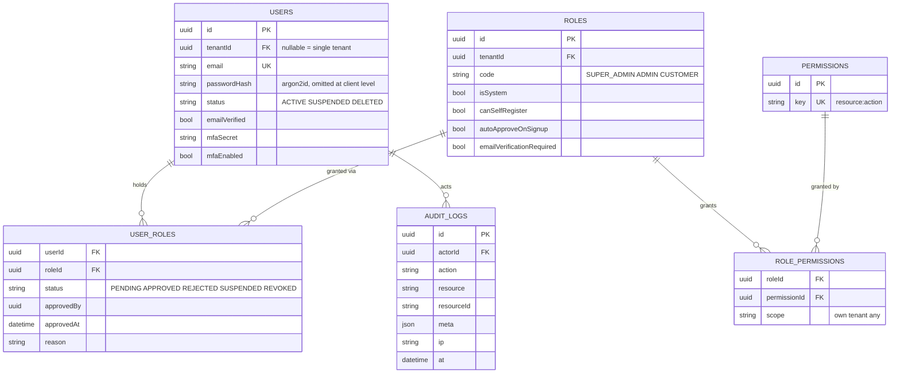

# Auth — data model

> **Two statuses on this page.** "Postgres schema" is **target design — not built**: there is no
> Postgres, no Prisma and no `prisma/` folder in `src/` today. "Tokens and cookies — as built" is
> **verified against the code on 2026-10-19**. Today identity lives in MongoDB (Mongoose models in
> `user/models/{User,Role,UserRole}/`) and sessions in Redis — see [flows.md](flows.md) and
> [../../platform/redis.md](../../platform/redis.md).

---

## Postgres schema — target design, not built

Six tables, deliberately minimal. Why `tenantId` and MFA are columns rather than tables is not yet
recorded in [../../decisions.md](../../decisions.md).

**Sessions are not a table.** They live in Redis, one key per device, and there is no refresh token
to store (decided 2026-08-24, [../../decisions.md](../../decisions.md)). An earlier draft had a
`sessions` table with `tokenHash`, `familyId`, `rotatedAt` and `usedAt` columns for refresh-token
rotation; that table is **superseded** and removed from the diagram. So are the `failedAttempts`
and `lockedUntil` columns on `users`: lockout counters live in Redis
(`auth/services/lockout.service.ts`).

The `status` values match the Mongo enums today (`User/types.ts:10-14`, `UserRole/types.ts:3-9`).

Notes worth internalising:

- Roles and permissions are **rows, not TypeScript enums**. A new client role is a seed row.
- One `.prisma` file per module: `prisma/models/{user,rbac,audit}.prisma`.
- Queries live in `models/<X>/repo.ts` — there is no `repositories/` folder in this design.

---

## Tokens and cookies — as built

Verified 2026-10-19.

**The session cookie.** One opaque token, `<sid>.<secret>`, in a cookie named per portal:
`<base>_admin`, `<base>_vendor`, `<base>_associate`, `<base>_customer` (`cookieHelper.ts:6-11,27`).
`<base>` is `COOKIE_NAME`, default `session_token` (`env.ts:194`). Redis stores only
`SHA-256(secret)` (`session.service.ts:131`).

| Option | Value | Where |
|---|---|---|
| `httpOnly` | always | `cookieHelper.ts:35` |
| `signed` | always, with `COOKIE_SECRET` via cookie-parser | `cookieHelper.ts:40`, `server.ts:99` |
| `sameSite` | `lax` — not configurable | `env.ts:198` |
| `secure` | **production only** (`NODE_ENV=production`) | `env.ts:197` |
| `domain` | `COOKIE_DOMAIN` if set | `cookieHelper.ts:41` |
| `maxAge` | `COOKIE_MAX_AGE_MS`, default the 7-day session lifetime; renewed on each authenticated request, never past the 30-day cap | `env.ts:201`, `session.service.ts:85-86` |

**ADMIN and SUPER_ADMIN share one cookie.** Both role codes map to the `admin` portal
(`cookieHelper.ts:15-21`), and either one may log in there: when the user does not hold ADMIN,
login takes the held role on the same portal, so a SUPER_ADMIN-only user is admitted as
SUPER_ADMIN (`auth.service.ts:163-166`). The portal list is a constant keyed by role code; moving
it to configuration is not built.

**Only signed cookies are read.** `readCookie` looks in `req.signedCookies` and nowhere else
(`cookieHelper.ts:72-77`). cookie-parser leaves an unsigned or tampered value in `req.cookies`, so
such a cookie is treated as no cookie at all. The signature is the first gate; the session itself
is still protected by the secret checked against its hash in Redis.

**The reset cookie.** `<base>_reset` holds a password-reset id between `/verify-otp` and
`/reset-password`, with the same options (`cookieHelper.ts:23,52-58`). It is not a session and is
outside the portal map. The id is 32 random bytes; Redis keeps it **as is** in the key name,
`reset_session:<resetId>`, holding the email, for `RESET_TOKEN_EXPIRY_MINUTES` (default 5)
(`session.service.ts:285-289`, `env.ts:229`).

**The CSRF cookie.** `csrf_token_<portal>` is deliberately **readable** (`httpOnly: false`) and
unsigned, and lives 30 days (`csrf.ts:28-29,39-47`). The client echoes its value in `x-csrf-token`.

No JWT, no refresh token, no `kid` key map — see [../../decisions.md](../../decisions.md).

## Redis keys

Documented once, in [../../platform/redis.md](../../platform/redis.md). Repeating the key map here
would leave two versions to drift apart.
