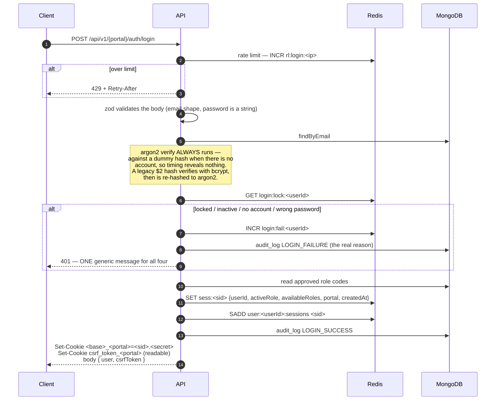
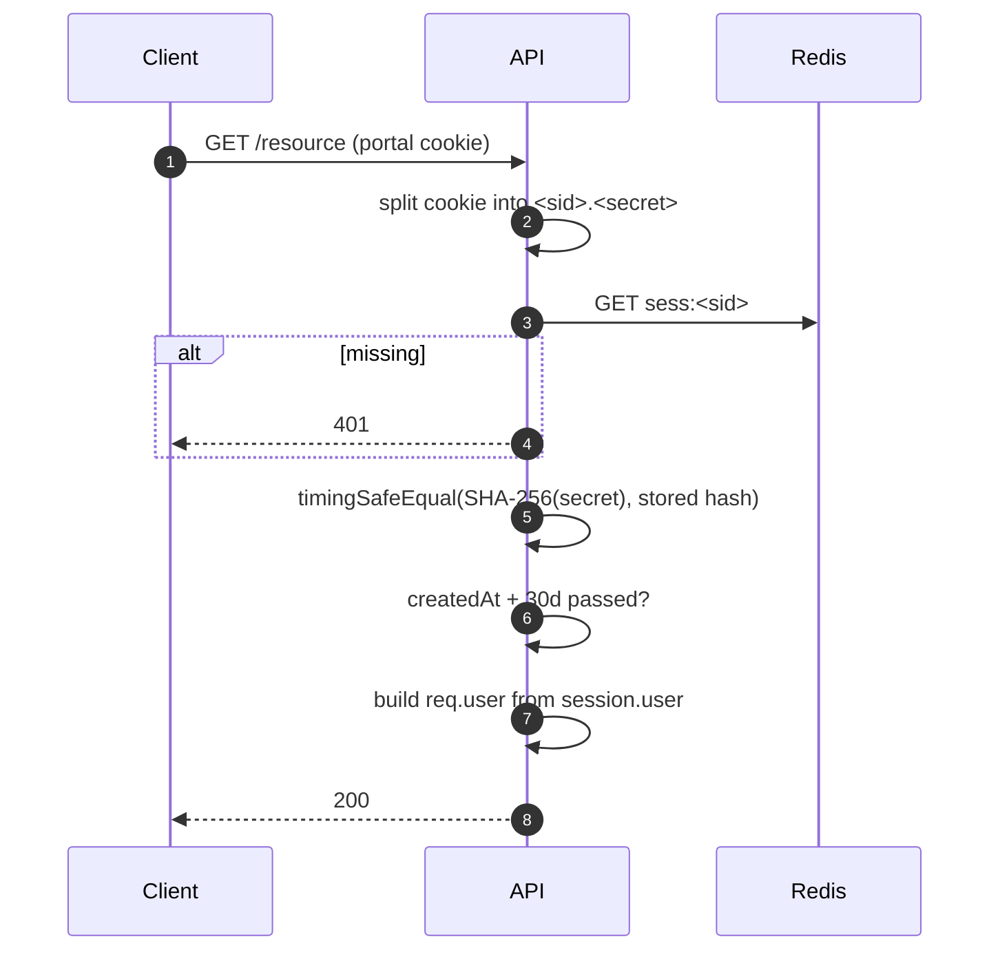
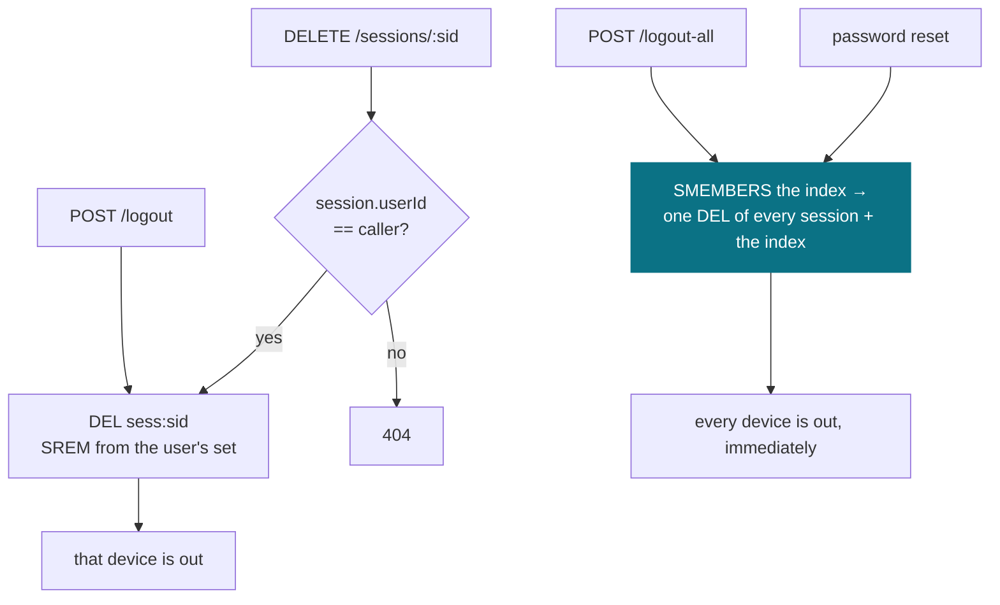
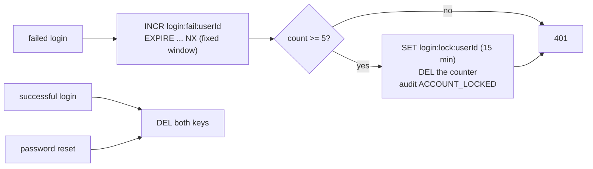

# Auth — flows

> **Runtime-verified 2026-09-01** against live Mongo + Redis: login, `GET /me` served from the session,
> self-service profile edit reflected without re-login, admin suspension revoking a live session (401),
> logout with and without CSRF (200 / 403), and identical responses for known vs unknown addresses on
> forgot-password. **Not exercised:** account lockout, Google OAuth (needs a real ID token), OTP email
> delivery. No production build has been run. Citations re-checked against the code on 2026-10-19.
> This describes what the code does now. There is no JWT and no refresh token — see
> [../../decisions.md](../../decisions.md) for why they were dropped.

Four flows carry the whole system: login, the authenticated request, revocation, and lockout.

---

## 1. Login

Two things are deliberate and easy to undo by accident:

1. **The hash always runs.** Returning early for an unknown email makes response time an
   account-existence oracle. Every failure path pays the same argon2 cost.
2. **One generic 401.** Wrong password, locked, inactive and no-such-account are indistinguishable
   to the caller. The real reason exists only in the audit log.

---

## 2. Authenticated request — the hot path

**One Redis read. Zero writes. No database call at all.** The sliding TTL refresh only fires once
less than half the lifetime remains, and it is fire-and-forget.

The display fields `req.user` promises (`email`, `firstName`, `lastName`, `emailVerified`,
`profileImage`) are copied into the session record at login (`session.service.ts:116-122`) and read
straight back out (`middlewares/authenticate.ts:24-33`), so no Mongo read is left on this path.

**Keeping the copy honest.** A cached field is a stale field unless something updates it:

| When | What happens | Where |
|---|---|---|
| Account suspended | **every session revoked before the status is saved** | `user/controllers/admin/managedUser.ts:231` → `revokeUserSessions` |
| Email verified | that user's sessions are rewritten | `auth/controllers/shared/emailVerification.ts:42` |
| Name or avatar edited **by an admin** | that user's sessions are rewritten | `user/controllers/admin/managedUser.ts:217,254,269` → `syncSessionUser` |
| Name or avatar edited **by the user** | that user's sessions are rewritten | `user/controllers/shared/profile.ts:34,47,62` → `syncSessionUser` |

A rewrite uses `SET ... KEEPTTL` (`utils/redisKeys.ts:48-52`), so refreshing display fields never
extends a session. Without that, editing an avatar on one device would push every other device's
idle expiry back to a full lifetime.

8 call sites in total (4 admin, 3 self-service, 1 email verification). The admin ones sit in one
controller factory that the vendor, customer and associate admin routers all share
(`user/routes/admin/managedUser.ts:21`), and the self-service ones in one file all three portals'
profile routes import. The self-service row is the
easy one to forget and the most visible when missed — it is the path a user actually takes to rename
themselves, and skipping it leaves `/me` showing the old name until the next login.

The suspension row is the load-bearing one. The middleware no longer checks `user.status`, so
revocation is the *only* thing standing between a suspended account and a live session. Nothing
cached here grants access on its own: authorization reads `availableRoles`, which is set at login
and re-set by `switchActiveRole`.

**Any database call added to `middlewares/authenticate.ts` is a blocking review finding.**

---

## 3. Revocation

Revocation is a delete, so it takes effect on the very next request. There is no epoch counter and
no token blocklist: the per-user index means we can always enumerate what to delete.

Ownership on `DELETE /sessions/:sid` is checked by reading that one session and comparing its
`userId` — one Redis read, not a scan of the caller's whole device list.

---

## 4. Lockout

Per **account**, in Redis, separate from the per-IP rate limiter.

The counter's own TTL is the window, so attempts age out on their own. The previous MongoDB version
only reset on a successful login, which meant every failure after the fifth re-locked the account
for another full duration — effectively permanent for anyone who kept trying.

**Password reset clears the lock.** It is the only recovery path a locked-out user has.

---

## Where CSRF fits

Login issues a readable `csrf_token_<portal>` cookie and returns the same value in the body. Every
state-changing authenticated request must echo it in the `x-csrf-token` header.

The token is `<random>.<HMAC(cookie secret, sid + random)>`, so it is bound to the session. A plain
equality check would trust that only our origin can *write* the cookie — untrue when `COOKIE_DOMAIN`
is a parent domain, where a sibling subdomain can plant a matching pair. The signature only ever
verifies against the attacker's own sid.

One cookie **per portal**, mirroring the session cookies: a single shared one would bind to whichever
portal logged in last, so a browser signed into admin *and* customer would fail on the other.

Pre-session endpoints cannot require it — `/login`, `/register`, `/oauth/:provider`,
`/forgot-password`, `/verify-otp`, `/reset-password`, `/verify-email` and `/send-otp` are all
reachable before a token exists. See [../../platform/rate-limiting.md](../../platform/rate-limiting.md)
for the sibling per-endpoint controls.
