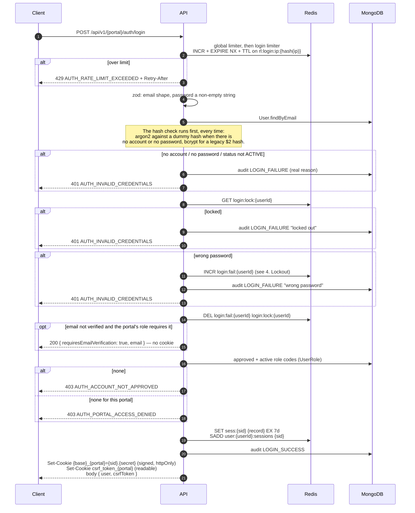
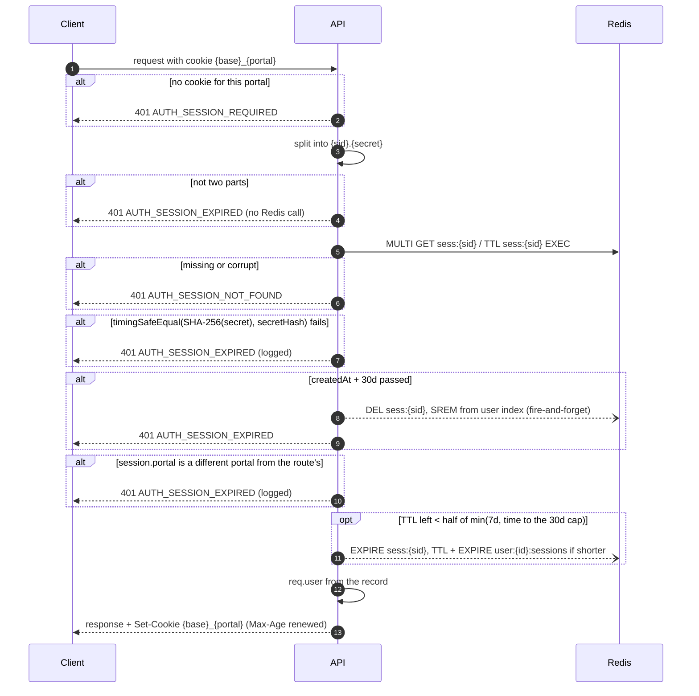
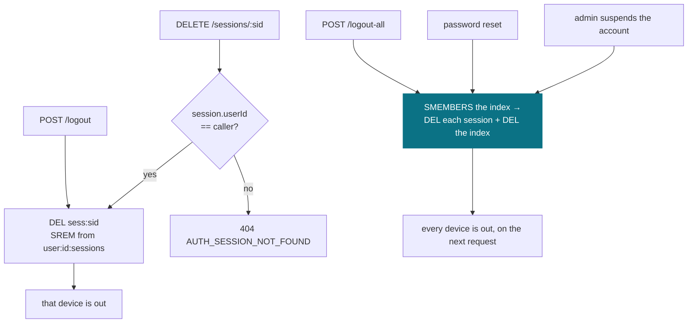
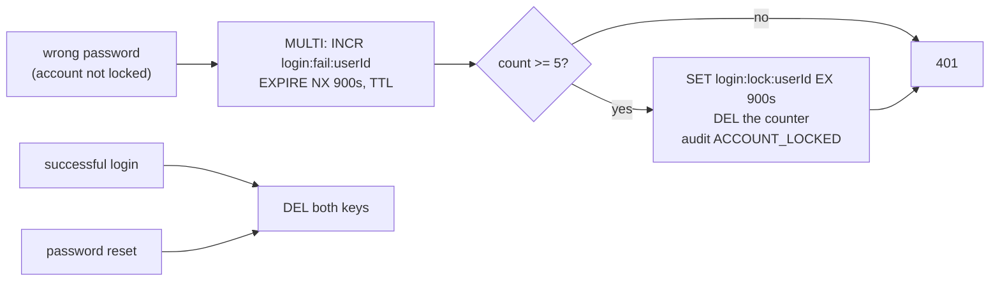

# Auth — flows

> **Verified against the code on 2026-10-19.** Line numbers refer to the working tree of branch
> `fix/code-audit-and-deps`. A runtime check on 2026-09-01 (live Mongo + Redis) covered login,
> `/me`, profile sync, suspension, logout with and without CSRF, and forgot-password responses; it
> was **not re-run** after this branch's changes. Never exercised: lockout, Google OAuth, OTP email
> delivery.

Four flows carry the system: login, the authenticated request, revocation, and lockout. There is no
JWT and no refresh token — see [../../decisions.md](../../decisions.md). Key names and TTLs are
listed once, in [../../platform/redis.md](../../platform/redis.md).

---

## 1. Login

`POST /api/v1/<portal>/auth/login`. The order below is the order in the code:
`auth.service.ts:156-202` calls `verifyPassword` in `password.service.ts:74-104`.

Step by step, with sources:

| Step | What happens | Where |
|---|---|---|
| Limiters | The global limiter (300/60 s per IP) runs on every API request; the login limiter (30/900 s) is **per IP only** | `server.ts:95`, `routes/shared/limits.ts:4-8`, `env.ts:253-260` |
| Hash first | The password is checked before any guard. No account, or no `passwordHash` (a Google-only user), runs `dummyVerify` instead | `password.service.ts:77-80`, `28-34` |
| Guards | no account → no password → status not `ACTIVE` → locked → wrong password, each a generic 401 | `password.service.ts:82-99` |
| Success | Both lockout keys deleted; a `$2` or weaker argon2 hash is re-hashed in the background | `password.service.ts:101-102`, `46-61` |
| Email gate | Applies to every portal (no customer bypass) when the role's `emailVerificationRequired` is set | `auth.service.ts:162-167`, response at `portalAuth.ts:37-39` |
| Roles | Only `APPROVED` + `isActive` user roles count, and only for roles whose own `Role.isActive` is true | `auth.service.ts:169-175`, `UserRole/schema.ts:72-81` |
| Session | 16-byte random sid, 32-byte random secret, only `SHA-256(secret)` stored | `session.service.ts:122-149` |
| Device cap | Oldest sessions beyond `SESSION_MAX_PER_USER` (10) are evicted, fire-and-forget | `session.service.ts:94-104`, `env.ts:192` |
| Cookies | Session cookie, then CSRF cookie; the CSRF token is also in the body | `portalAuth.ts:41-45` |

**The session record** (`Session/types.ts:31-44`): `sid`, `secretHash`, `userId`, `user` (the five
display fields `email`, `firstName`, `lastName`, `emailVerified`, `profileImage`), `activeRole`,
`availableRoles`, `portal`, `ipAddress`, `userAgent`, `deviceInfo`, `createdAt`, `lastSeenAt`.
`portal` holds the **role code** used at login (for example `ADMIN`), not the URL segment
(`auth.service.ts:182`).

**Key names.** `sid` is 32 hex characters. User-supplied segments are hashed to 32 hex characters
by `identifierHash` before they go into a key: the rate-limit key is `rl:login:ip:<hash(ip)>`,
OTP keys are `otp:<purpose>:<hash(email)>:<part>`. The session key uses the sid; the user index and
lockout keys use the Mongo user id (`redisKeys.ts:22-39`).

Two things are deliberate and easy to undo by accident:

1. **The hash always runs.** Returning early for an unknown email makes response time an
   account-existence oracle. Every failure path pays the same hash cost.
2. **One generic 401 before the password is proven.** No account, no password, inactive, locked
   and wrong password all return `AUTH_INVALID_CREDENTIALS`. The real reason is in the audit log
   (`password.service.ts:63-72`).

The three later responses — `requiresEmailVerification`, `ACCOUNT_NOT_APPROVED` and
`PORTAL_ACCESS_DENIED` — **are** distinct. They are reachable only with the correct password, so
they tell the account owner something, not a stranger.

> **Real world:** Omar holds only VENDOR. He types his correct password into the customer portal.
> He gets `403 AUTH_PORTAL_ACCESS_DENIED`. Someone guessing passwords for Omar's email gets the same
> `401` for every wrong guess, and learns nothing.

---

## 2. Authenticated request — the hot path

**Authenticating a request costs one Redis round trip (GET + TTL in one MULTI on the session key)
and no database call.** It writes only when less than half the session TTL remains: an EXPIRE on
the session key and its user index, fire-and-forget. The global rate limiter also runs on every API
request (`server.ts:95`) — that is the limiter, not authentication; see
[../../platform/rate-limiting.md](../../platform/rate-limiting.md).

| Step | Where |
|---|---|
| Read the portal's cookie — the signed value only; an unsigned or tampered one counts as no cookie | `authenticate.ts:35`, `cookieHelper.ts:73-80` |
| Malformed token | `session.service.ts:155-159` |
| One MULTI: GET + TTL | `Session/repo.ts:96-101` → `redisKeys.ts:71-76` |
| Secret check, absolute cap, portal check | `session.service.ts:165-176` |
| Every verification failure clears the cookie | `authenticate.ts:39-42` |
| TTL refresh, only past half | `session.service.ts:72-81` → `Session/repo.ts:125-137` |
| Cookie Max-Age renewed on every success, never past the 30-day cap | `authenticate.ts:46`, `session.service.ts:85-86`, `cookieHelper.ts:62-70` |
| `req.user` built from the record | `authenticate.ts:19-28` |
| Redis down → error goes to `next()` → 500, not 401 | `authenticate.ts:30-31,51-53` |

**Why the refresh is a bare EXPIRE.** Re-saving the record read at the start of the request would
undo a role switch or profile sync that landed in between (`Session/repo.ts:133-134`). So
`lastSeenAt` is written only at login and at role switch (`session.service.ts:141,239`), not per
request.

**Portal isolation.** A token is accepted only on its own portal: `portalOf(session.portal)` must
equal `portalOf(routeRole)` (`session.service.ts:173-176`). ADMIN and SUPER_ADMIN map to the same
`admin` portal (`cookieHelper.ts:15-21`).

> **Real world:** someone copies a customer-portal cookie value into the `_admin` cookie. The
> cookie name now matches, but the record says `portal: CUSTOMER`, so the admin API answers `401`.

### Keeping the cached copy honest

The display fields are copied into the record at login (`session.service.ts:114-120`) and read back
by `authenticate.ts:19-28`. A copy goes stale unless something updates it:

| When | What happens | Where |
|---|---|---|
| Account suspended by an admin | **every session revoked before the status is saved** | `user/controllers/admin/managedUser.ts:249-254` |
| Email verified | that user's sessions rewritten | `auth/controllers/shared/emailVerification.ts:43` |
| Name or avatar edited by an admin | sessions rewritten | `user/controllers/admin/managedUser.ts:235,274,290` |
| Name or avatar edited by the user | sessions rewritten | `user/controllers/shared/profile.ts:36,50,66` |

8 call sites (4 admin, 3 self-service, 1 email verification). The admin ones sit in one controller
factory that the vendor, customer and associate admin routers share
(`user/routes/admin/managedUser.ts:16-21`). A rewrite uses `SET ... KEEPTTL`
(`Session/repo.ts:92-94`, `redisKeys.ts:54-58`), so editing an avatar never extends a session.

The suspension row is the load-bearing one: `authenticate` does not read `user.status`, so
revocation is the only thing that ends a suspended account's access.

### What the session copy does decide: roles

**`availableRoles` is a snapshot taken at login, and authorization reads it.** `authorizeRoles`
checks `req.user.availableRoles` (`authenticate.ts:57-60`), which comes straight from the record.
Nothing refreshes it:

- `switch-role` writes back the session's own snapshot — the controller passes
  `req.user.availableRoles` (`portalAuth.ts:73-77`, `session.service.ts:235-240`). The write is
  `saveFields`, which keeps the key's TTL, so a switch never extends the session
  (`session.service.ts:242`, `Session/repo.ts:92-94`).
- No endpoint approves, rejects, suspends or revokes a user role. The `UserRole` schema has the
  columns (`UserRole/schema.ts:41-54`); nothing in `src/` writes them after creation.
- Deactivating a role (`PATCH /admin/roles/:id/toggle-status`, `user/controllers/admin/role.ts:90-95`)
  touches no session. It takes effect at the **next login**: `getUserRoleCodes` skips roles whose
  `Role.isActive` is false (`UserRole/schema.ts:72-81`). Sessions already open keep the code until
  they end.

> **Real world:** a database operator sets Lena's ADMIN user role to `REJECTED` at 09:00. Her
> laptop session from 08:00 still lists ADMIN and keeps passing admin checks until it ends —
> logout, password reset, suspension, or expiry (7 days idle, 30 days at most). To cut her off now,
> suspend the account, which revokes every session.

**Any database call added to `authenticate.ts` is a blocking review finding.**

---

## 3. Revocation

| Path | Where |
|---|---|
| Logout deletes the current session | `portalAuth.ts:48-63` → `Session/repo.ts:108-111` |
| Revoke one device: one read to check ownership, then delete | `session.service.ts:191-197` |
| Logout-all, password reset, suspension | `auth.service.ts:204-211`, `passwordReset.ts:141`, `auth/index.ts:25-26` → `Session/repo.ts:119-123` |

Revocation is a delete, so it takes effect on the very next request. Each `DEL` is single-key on
purpose: session keys scatter across slots on a Redis cluster (`Session/repo.ts:63-64`).

---

## 4. Lockout

Per **account**, in Redis, separate from the per-IP login limiter (`lockout.service.ts`).

- **Fixed window.** `EXPIRE ... NX` sets the TTL once, on the first failure, and never renews it
  (`redisKeys.ts:133-139`). Five failures inside 900 s lock the account for 900 s
  (`lockout.service.ts:27-43`, `env.ts:274-278`).
- **Only a wrong password counts.** A login on a locked account fails before the password branch,
  so it does not add to the counter (`password.service.ts:89-99`).
- **Counting fails open.** If Redis errors while counting, the failure is logged and not counted
  (`lockout.service.ts:44-49`). The lock *check* does not fail open: a Redis error there is a 500.
- **Password reset clears the lock** (`passwordReset.ts:140`). It is the only recovery path a
  locked-out user has.

---

## Where CSRF fits

CSRF (cross-site request forgery) is a page on another site making the browser send a request that
carries our cookies. The defence is a token the other site cannot read.

Login issues a readable `csrf_token_<portal>` cookie and returns the same value in the body
(`csrf.ts:31-50`, `portalAuth.ts:41-45`). Every `POST`, `PUT`, `PATCH` and `DELETE` that runs
`verifyCsrf` must echo it in the `x-csrf-token` header; `GET`, `HEAD` and `OPTIONS` are exempt
(`csrf.ts:19,84-109`).

| Where it runs | Where |
|---|---|
| Per route on the auth routers, after `authenticate` | e.g. `routes/admin/auth.ts:18-25` |
| Router-wide for every module mounted after auth (user, referral, dashboard) | `routes/index.ts:11-19` |

**Mobile and server-to-server clients are not exempt.** There is no header-based bypass. A
non-browser client must keep both cookies and send the header on every write. The only way out is
`CSRF_ENABLED=false`, which turns the check off for every client (`env.ts:297`, `csrf.ts:85`).

The token is `<random>.<HMAC(COOKIE_SECRET, sid + random)>` (`csrf.ts:23-26,36-37`), so it is bound
to the session. A plain equality check would trust that only our origin can *write* the cookie —
untrue when `COOKIE_DOMAIN` is a parent domain, where a sibling subdomain can plant a matching pair.
The signature only ever verifies against the attacker's own sid.

The CSRF cookie lives 30 days, the absolute session cap, because a new one is issued only at login
(`csrf.ts:43-46`). One cookie **per portal**, mirroring the session cookies: a single shared one
would bind to whichever portal logged in last.

Pre-session endpoints do not run it — `/register`, `/login`, `/oauth/:provider`, `/forgot-password`,
`/verify-otp`, `/reset-password`, `/verify-email` and `/send-otp` are reachable before a token
exists. Their per-endpoint limits are in
[../../platform/rate-limiting.md](../../platform/rate-limiting.md).
