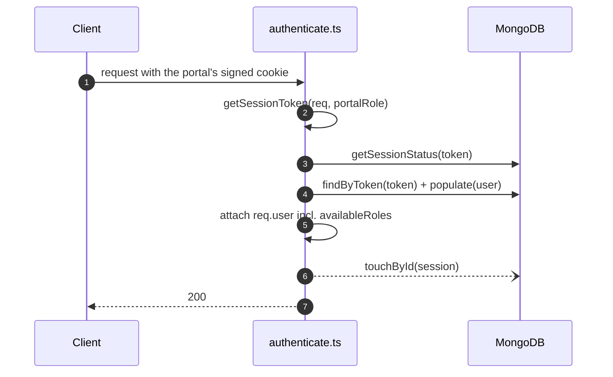

# Auth — how the current code actually works, and what replaces it

> **HISTORICAL — the session half of this migration is done (2026-08-24).** Status lines re-checked
> against the code on 2026-10-19. Sessions, lockout counters and OTP now live in Redis. The planned
> revocation *epoch* (a per-user counter bumped to kill every token) was **dropped, never built**
> ([../../decisions.md](../../decisions.md)). The Mongo `LoginSession` model, the lockout columns,
> `authorizeActiveRole` and `optionalAuth` are deleted (grep of `src/` finds none of them).
> Line numbers in the "What happened" sections refer to the code **as it was before** and no longer
> resolve; lines marked **Today** are current.
>
> Which problems are still true today: **1 fixed**, **2 fixed**, **3 still true**, **4 still true**,
> **5 still true** — see each problem's *Today* line. For what runs now, see [flows.md](flows.md) and
> [../../platform/redis.md](../../platform/redis.md).

This page explains what the inherited code did when someone logged in, why each piece was replaced,
and what breaks in the real world if it is not.

---

## What happened before the migration, step by step

### Logging in

`src/modules/auth/controllers/shared/authHelper.ts` → `login()` (that file is now
`services/auth.service.ts`)

1. Look up the user by email. **If no user exists, throw immediately** (`authHelper.ts:136`).
2. Reject if the account is not `ACTIVE` (403 `ACCOUNT_INACTIVE`), or if it is locked
   (403 `ACCOUNT_LOCKED`).
3. Compare the password with **bcryptjs at 10 salt rounds**
   (`src/modules/user/models/User/schema.ts:47,56`).
4. On failure, increment `failedLoginAttempts`; at 5, set `lockedUntil` to 15 minutes from now
   (`User/schema.ts:63-68`).
5. On success, reset the counter, collect the user's approved role codes, and create a session.
6. Return the raw session token, which the controller writes into a per-portal cookie.

### Creating the session

`src/modules/auth/models/LoginSession/schema.ts` → `createSession()`

```ts
const token = crypto.randomBytes(32).toString('hex');   // schema.ts:28

const existing = await this.findOne({ userId, isActive: true });
if (existing) {
  existing.token = token;          // schema.ts:42 — overwrites the previous device's token
  existing.activeRole = activeRole;
  existing.availableRoles = availableRoles;   // schema.ts:44 — a snapshot, frozen from here
  return existing.save();
}
```

The token is stored **exactly as it is sent to the browser** — `token: { type: String, unique: true }`
(`schema.ts:9`). No hashing.

### Every authenticated request afterwards

`src/middlewares/authenticate.ts` → `authenticate(portalRole)`



**Two awaited reads plus one un-awaited write, on every single request.** The `touchById` call is
not awaited (`authenticate.ts:57`), so it does not delay the response — but it is still a database
write per request, and it still competes for the same connection pool.

### Checking permission

```ts
// authenticate.ts:68
const hasRole = allowedRoles.some(role => (req.user.availableRoles || []).includes(role));
```

It checks **every role the user holds**, not the role they are currently acting as.
`authorizeActiveRole` (line 73) does the correct check, but the routes use `authorizeRoles`.

---

## The five problems, with what they look like in production

### 1. A database dump is a live session hijack

Session tokens are stored in plaintext (`LoginSession/schema.ts:9`). The value in the database
column *is* the value in the user's cookie.

> **Real world:** a read-only backup file is leaked, or a support engineer exports the collection
> for debugging. Anyone holding that file can paste any row's `token` into a cookie and be logged
> in as that user. No password needed, no alarm raised.

**Fix:** store `SHA-256(token)`. The plaintext then exists only in the user's cookie, and a dump is
worthless. Verification is a hash-and-compare — same speed.

**Today — fixed.** Redis stores only `SHA-256(secret)` (`session.service.ts:131`) and compares with
`timingSafeEqual` (`session.service.ts:49-54,165`).

### 2. One active session per user, globally

`createSession` overwrites the existing active row instead of adding one (`schema.ts:40-53`).

> **Real world:** Sara is logged into the admin portal on her laptop. She opens the app on her
> phone. The phone login overwrites the row's `token`, so the laptop's cookie no longer matches
> anything — her laptop is silently logged out mid-task. Worse, because the same row is reused
> across portals, logging into the vendor portal voids her own admin session.

**Fix:** one row **per device**. Sara's laptop, phone and tablet are three rows, each independently
revocable — which also makes a "your active devices" screen possible for the first time.

**Today — fixed.** Each login creates a new `sess:<sid>` key and adds it to `user:<id>:sessions`
(`session.service.ts:122-149`, `Session/repo.ts:86-90`); `GET /sessions` lists the devices.

### 3. Roles are frozen into the session

`availableRoles` is copied into the session row at login (`schema.ts:44`) and read from
`req.user.availableRoles` on every request thereafter.

> **Real world:** an employee leaves and an admin revokes their ADMIN role at 09:00. The employee's
> browser tab still holds a session created yesterday, so it keeps passing admin checks until that
> session expires — up to a week later (`SESSION_EXPIRY_MS` defaults to 7 days). Revocation
> appeared to work in the UI, and did nothing.

**Planned fix (dropped):** an epoch counter in Redis, bumped on role revocation. It was removed from
the design on 2026-08-24 ([../../decisions.md](../../decisions.md)); the per-user session index was
meant to let role changes delete or rewrite sessions directly instead.

**Today — still true.** `availableRoles` is copied into the Redis session at login
(`auth.service.ts:169-186`) and `authorizeRoles` reads it (`authenticate.ts:57-60`). No endpoint
changes a user role, and nothing rewrites `availableRoles` in live sessions; a deactivated role
is dropped only at the next login (`UserRole/schema.ts:72-81`). `switch-role` writes
the same snapshot back (`portalAuth.ts:73-77`). The window is shorter than before: 7 days idle,
30 days at most (`env.ts:5-6`). The only immediate cut-off is suspending the account, which deletes
every session ([flows.md](flows.md#what-the-session-copy-does-decide-roles)).

### 4. Holding a role is treated as using it

`authorizeRoles` checks `availableRoles` (`authenticate.ts:68`).

> **Real world:** a support agent has both CUSTOMER and ADMIN roles. They log into the customer
> portal to reproduce a bug — `activeRole` is CUSTOMER. Any endpoint guarded by
> `authorizeRoles(ADMIN)` still lets them through, because they *hold* ADMIN somewhere. The portal
> separation is real for cookies but not for authorization.

**Fix (target design — not built):** `requirePermission('resource:action')` reads permissions
written for the role actually being used. See [authorization.md](authorization.md).

**Today — still true.** `authorizeRoles` checks `availableRoles`, not `activeRole`
(`authenticate.ts:57-60`); it is open question 1 in [../../decisions.md](../../decisions.md). Portal
isolation is now enforced separately: a session works only on the portal it logged in to
(`session.service.ts:173-176`), so the support agent above needs a session on the admin portal —
but once there, acting as any role, they pass every admin check.

### 5. Every client's roles require a code change

**Today — still true.** `ROLE_CODE` is a TypeScript `as const` object
(`src/modules/user/models/Role/types.ts:10-16`), and `Role.code` is validated against it at the
schema level: `enum: Object.values(ROLE_CODE)` (`src/modules/user/models/Role/schema.ts:11`), as is
`UserRole.roleCode` (`UserRole/schema.ts:22`). It is also used by the 4 auth controller folders
(`auth/controllers/<portal>/index.ts:14`), every route file that calls `authenticate`, and the
cookie map, which is keyed by the same role-code strings (`utils/cookieHelper.ts:15-21`).

> **Real world:** a client asks for a "Regional Manager" who can approve vendors in their region but
> cannot issue refunds. Today that means editing the enum, the cookie map, the route guards and the
> controllers, then a release. Under the target design it is two rows in `roles` and
> `role_permissions` — a seed edit, no deploy.

**Fix:** roles and permissions become database rows. This is the single change that makes the
starter reusable.

---

## Smaller findings, verified

The "Where" column is the pre-migration code; the "Today" column is current.

| What | Where (before) | Why it matters | Today |
|---|---|---|---|
| Login returns before hashing when the email is unknown | `authHelper.ts:136` | Response time reveals whether an account exists | **Fixed** — dummy hash, `password.service.ts:77-80` |
| Distinct error codes per failure reason | `ACCOUNT_INACTIVE`, `ACCOUNT_LOCKED`, `INVALID_CREDENTIALS`, `PORTAL_ACCESS_DENIED`, `ACCOUNT_NOT_APPROVED` | Each one confirms an account exists | **Fixed** before the password is proven — one generic 401, `password.service.ts:82-99`. `ACCOUNT_NOT_APPROVED` and `PORTAL_ACCESS_DENIED` remain, after a correct password only (`auth.service.ts:169-175`) |
| `{ requiresEmailVerification: true, email }` returned | `authHelper.ts:151-153` | Confirms the address is registered | **Fixed** — still returned, but only after a correct password (`auth.service.ts:160-167`) |
| Lockout counter never resets on its own | `User/schema.ts:63-68` | After 5 failures, every later failure re-locked for another 15 minutes | **Fixed** — Redis counter with a fixed window, `lockout.service.ts:27-43` |
| Lock duration hardcoded as `15 * 60 * 1000` | `User/schema.ts:66` | Magic value — [coding-practices §5](../../standards/coding-practices.md) | **Fixed** — `LOCKOUT_DURATION_SECONDS`, `env.ts:277` |
| bcryptjs, 10 rounds | `User/schema.ts:2,47` | bcrypt is no longer the recommended default | **Fixed** — argon2id; bcryptjs only verifies legacy `$2` hashes, `password.service.ts:36-47` |
| No refresh token at all | — | One sliding token | **Obsolete by decision** — no refresh token; absolute 30-day cap instead, `session.service.ts:68-69,169-172` |
| No rate limiting on login/OTP endpoints | Redis unused for this | An attacker could spray many accounts | **Fixed** — `routes/shared/limits.ts` |
| `optionalAuth` accepts any portal's cookie | `authenticate.ts:81-99` | Removes portal isolation if used | **Fixed** — deleted; `authenticate(roleCode)` requires a role (`authenticate.ts:32`), and the session's portal must match (`session.service.ts:173-176`) |

---

## What the inherited code got right — kept

Each item names where it lives **today**.

- **Opaque random tokens, not a JWT in a cookie** — the correct default for a first-party web app:
  instant revocation, nothing sensitive in the token. Today: `session.service.ts:122-149`.
- **Per-portal cookie isolation** — `session_token_admin`, `_vendor`, `_associate`, `_customer`,
  plus `_reset`. Today: `cookieHelper.ts:6-32`, now backed by a portal check on the session itself
  (`session.service.ts:173-176`). Every call passes a role — 32 `authenticate(ROLE_CODE.…)` call
  sites in 18 route files, and the argument is required (`authenticate.ts:32`). The portal list is
  still a constant keyed by role code, not configuration.
- **Signed cookies** — `signed: true` plus `httpOnly`, `secure`, `sameSite` (`cookieHelper.ts:34-42`).
  Only the signed value is read (`cookieHelper.ts:72-77`): an unsigned or tampered cookie counts as
  no cookie. The secret checked in Redis still protects the session — see [data-model.md](data-model.md#tokens-and-cookies--as-built).
- **Automatic expiry.** The Mongo TTL index is gone with `LoginSession`; every Redis session key
  carries a TTL instead (`Session/repo.ts:86-90`). A Postgres session table would need a cleanup
  job — moot while sessions stay in Redis.
- **Role switch validates the target** against `availableRoles` (`session.service.ts:227-229`).
- **`UserRole` lifecycle columns** — who/when/why for approve, reject, suspend and revoke
  (`UserRole/schema.ts:41-54`). Only the columns: nothing in `src/` writes the reject, suspend or
  revoke ones, and approval happens only at creation (`UserRole/schema.ts:107-112`).
- **Data-driven role flags** — `canSelfRegister`, `autoApproveOnSignup`,
  `emailVerificationRequired` (`Role/schema.ts:29-40`). The target extends the idea to permissions.

---

## The mapping, in one table

| Before | Planned | Built today (2026-10-19) |
|---|---|---|
| `LoginSession`: one active row per user, plaintext token, `availableRoles` snapshot | `sessions`: one row per device, `SHA-256` token hash, `familyId` | Redis key per device, `SHA-256(secret)`, no `familyId` (no refresh token). `availableRoles` is **still a snapshot** — problem 3 open |
| `ROLE_CODE` enum, enforced in the Mongoose schema | `roles` + `permissions` + `role_permissions` rows | **Not built** — problem 5 open |
| `authorizeRoles(...)` on `availableRoles` | `requirePermission(key)` + `own`/`tenant`/`any` scope | **Not built** — problem 4 open |
| 2 reads + 1 write per request | 2 Redis reads, zero Postgres | One Redis round trip, no database call; a write only past half the TTL ([flows.md §2](flows.md#2-authenticated-request--the-hot-path)) |
| no refresh endpoint | rotation + reuse detection + absolute lifetime cap | Rotation dropped by decision; absolute 30-day cap built |
| bcryptjs (10 rounds) | argon2id (`m=19456, t=2, p=1` minimum) | Built (`env.ts:289-293`) |
| `authHelper.ts` in `controllers/shared/` | `services/auth.service.ts` | Done |
| `authenticate(portalRole)` | kept, portal list from env | Kept as `authenticate(roleCode)`; portal list is a constant in `cookieHelper.ts:6-21` |

Full context and the complete finding list: [../../platform/scaling.md](../../platform/scaling.md).
