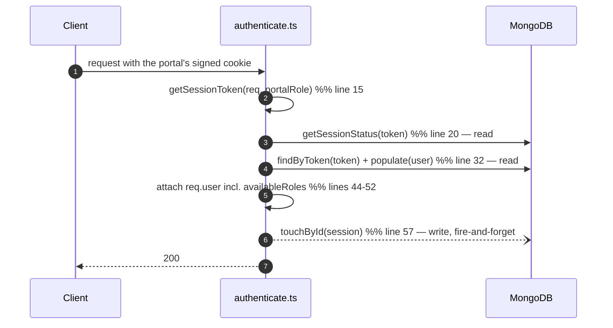

# Auth — how the current code actually works, and what replaces it

> **HISTORICAL — the session half of this migration is done (2026-08-24).**
> Sessions, revocation epochs, lockout counters and OTP now live in Redis; the Mongo
> `LoginSession` model, the lockout columns and the dead OTP columns are deleted, and so are
> `authorizeActiveRole` and `optionalAuth`. Line numbers below refer to the code **as it was
> before** that change and no longer resolve.
>
> Kept because the reasoning still governs the design: problems 1-4 are what the Redis session
> layer exists to fix, and problem 5 (roles as an enum) is **still true today**.
> For what runs now, see [../../platform/redis.md](../../platform/redis.md).

If you are new to this repo, read this page first. It explains what happens today when someone logs
in, why each piece is being replaced, and what breaks in the real world if it is not.

---

## What happens today, step by step

### Logging in

`src/modules/auth/controllers/shared/authHelper.ts` → `login()`

1. Look up the user by email. **If no user exists, throw immediately** (`authHelper.ts:136`).
2. Reject if the account is not `ACTIVE` (403 `ACCOUNT_INACTIVE`), or if it is locked
   (403 `ACCOUNT_LOCKED`).
3. Compare the password with **bcryptjs at 10 salt rounds**
   (`src/modules/user/models/User/schema.ts:47,56`).
4. On failure, increment `failedLoginAttempts`; at 5, set `lockedUntil` to 15 minutes from now
   (`User/schema.ts:63-68`).
5. On success, reset the counter, collect the user's approved role codes, and create a session.
6. Return the raw session token, which the controller writes into a per-portal cookie.

### Creating the session

`src/modules/auth/models/LoginSession/schema.ts` → `createSession()`

```ts
const token = crypto.randomBytes(32).toString('hex');   // schema.ts:28

const existing = await this.findOne({ userId, isActive: true });
if (existing) {
  existing.token = token;          // schema.ts:42 — overwrites the previous device's token
  existing.activeRole = activeRole;
  existing.availableRoles = availableRoles;   // schema.ts:44 — a snapshot, frozen from here
  return existing.save();
}
```

The token is stored **exactly as it is sent to the browser** — `token: { type: String, unique: true }`
(`schema.ts:9`). No hashing.

### Every authenticated request afterwards

`src/middlewares/authenticate.ts` → `authenticate(portalRole)`



**Two awaited reads plus one un-awaited write, on every single request.** The `touchById` call is
not awaited (`authenticate.ts:57`), so it does not delay the response — but it is still a database
write per request, and it still competes for the same connection pool.

### Checking permission

```ts
// authenticate.ts:68
const hasRole = allowedRoles.some(role => (req.user.availableRoles || []).includes(role));
```

It checks **every role the user holds**, not the role they are currently acting as.
`authorizeActiveRole` (line 73) does the correct check, but the routes use `authorizeRoles`.

---

## The five problems, with what they look like in production

### 1. A database dump is a live session hijack

Session tokens are stored in plaintext (`LoginSession/schema.ts:9`). The value in the database
column *is* the value in the user's cookie.

> **Real world:** a read-only backup file is leaked, or a support engineer exports the collection
> for debugging. Anyone holding that file can paste any row's `token` into a cookie and be logged
> in as that user. No password needed, no alarm raised.

**Fix:** store `SHA-256(token)`. The plaintext then exists only in the user's cookie, and a dump is
worthless. Verification is a hash-and-compare — same speed.

### 2. One active session per user, globally

`createSession` overwrites the existing active row instead of adding one (`schema.ts:40-53`).

> **Real world:** Sara is logged into the admin portal on her laptop. She opens the app on her
> phone. The phone login overwrites the row's `token`, so the laptop's cookie no longer matches
> anything — her laptop is silently logged out mid-task. Worse, because the same row is reused
> across portals, logging into the vendor portal voids her own admin session.

**Fix:** one row **per device**. Sara's laptop, phone and tablet are three rows, each independently
revocable — which also makes a "your active devices" screen possible for the first time.

### 3. Roles are frozen into the session

`availableRoles` is copied into the session row at login (`schema.ts:44`) and read from
`req.user.availableRoles` on every request thereafter.

> **Real world:** an employee leaves and an admin revokes their ADMIN role at 09:00. The employee's
> browser tab still holds a session created yesterday, so it keeps passing admin checks until that
> session expires — up to a week later (`SESSION_EXPIRY_MS` defaults to 7 days). Revocation
> appeared to work in the UI, and did nothing.

**Fix:** an epoch counter in Redis. Revoking a role runs `INCR user:<id>:epoch`, and every live
token fails its next check within milliseconds. See [flows.md](flows.md).

### 4. Holding a role is treated as using it

`authorizeRoles` checks `availableRoles` (`authenticate.ts:68`).

> **Real world:** a support agent has both CUSTOMER and ADMIN roles. They log into the customer
> portal to reproduce a bug — `activeRole` is CUSTOMER. Any endpoint guarded by
> `authorizeRoles(ADMIN)` still lets them through, because they *hold* ADMIN somewhere. The portal
> separation is real for cookies but not for authorization.

**Fix:** `requirePermission('resource:action')` reads permissions from the session Redis entry,
which is written for the role actually being used. See [authorization.md](authorization.md).

### 5. Every client's roles require a code change

`ROLE_CODE` is a TypeScript enum, and `Role.code` is validated against it at the schema level:
`enum: Object.values(ROLE_CODE)` (`src/modules/user/models/Role/schema.ts:10`). It is also
referenced in 4 controller folders, every auth route file, and the cookie map.

> **Real world:** a client asks for a "Regional Manager" who can approve vendors in their region but
> cannot issue refunds. Today that means editing the enum, the cookie map, the route guards and the
> controllers, then a release. Under the target design it is two rows in `roles` and
> `role_permissions` — a seed edit, no deploy.

**Fix:** roles and permissions become database rows. This is the single change that makes the
starter reusable.

---

## Smaller findings, verified

| What | Where | Why it matters |
|---|---|---|
| Login returns before hashing when the email is unknown | `authHelper.ts:136` | Response time reveals whether an account exists. Fix: always verify against a dummy hash |
| Distinct error codes per failure reason | `ACCOUNT_INACTIVE`, `ACCOUNT_LOCKED`, `INVALID_CREDENTIALS`, `PORTAL_ACCESS_DENIED`, `ACCOUNT_NOT_APPROVED` | Each one confirms an account exists. Fix: one generic failure, real reason to the audit log |
| `{ requiresEmailVerification: true, email }` returned | `authHelper.ts:151-153` | Confirms the address is registered |
| Lockout counter never resets on its own | `User/schema.ts:63-68` | Only a *successful* login clears `failedLoginAttempts`. After 5 failures, every later failure re-locks for another 15 minutes. Not exponential backoff — sticky |
| Lock duration hardcoded as `15 * 60 * 1000` | `User/schema.ts:66` | Magic value, not configurable per client — violates [coding-practices §5](../../standards/coding-practices.md) |
| bcryptjs, 10 rounds | `User/schema.ts:2,47` | The slowest bcrypt implementation, and bcrypt is no longer the recommended default. Fix: argon2id |
| No refresh token at all | — | One sliding token. A stolen cookie works until expiry, and nothing can detect the theft |
| No rate limiting on login/OTP endpoints | Redis is a dependency but unused for this | Per-account lockout exists; per-IP and per-account *throttling* does not, so an attacker can spray many accounts freely |
| `optionalAuth` accepts any portal's cookie | `authenticate.ts:81-99` calls `getSessionToken(req)` with no role, which scans every portal cookie (`cookieHelper.ts:62-68`) | **Currently harmless — it is never used.** But it is a loaded gun: using it, or calling `authenticate()` with no argument, silently removes portal isolation |

---

## What the current code gets right — keep it

Do not "fix" these during the migration.

- **Opaque random tokens, not a JWT in a cookie** (`schema.ts:27-29`) — the correct default for a
  first-party web app: instant revocation, nothing sensitive in the token.
- **Per-portal cookie isolation** (`cookieHelper.ts:6-13`) — `session_token_admin`,
  `_vendor`, `_associate`, `_customer`, `_reset`. An admin cookie cannot be replayed against the
  customer API. Every route passes an explicit portal (verified: 24 call sites, none arg-less), so
  this holds today. Keep it — but drive the portal list from env instead of the role enum.
- **Signed cookies** (`cookieHelper.ts:33`) — `signed: true` plus `httpOnly`, `secure`, `sameSite`.
- **A TTL index on `expiresAt`** (`schema.ts:25`) — MongoDB deletes expired sessions automatically.
  Postgres has no equivalent, so the target needs a cleanup job. **Do not lose this behaviour.**
- **`switchRoleById` validates the target role** against `availableRoles` before switching
  (`schema.ts:97`).
- **`UserRole` approve / reject / suspend / revoke lifecycle** with who/when/why columns.
- **Data-driven role flags** — `canSelfRegister`, `autoApproveOnSignup`,
  `emailVerificationRequired` (`Role/schema.ts:28-39`). This is already the right idea; the target
  extends it to permissions.

---

## The mapping, in one table

| Today | Target | Fixes |
|---|---|---|
| `LoginSession`: one active row per user, plaintext token, `availableRoles` snapshot | `sessions`: one row per device, `SHA-256` token hash, `familyId` | problems 1, 2, 3 |
| `ROLE_CODE` enum, enforced in the Mongoose schema | `roles` + `permissions` + `role_permissions` rows | problem 5 |
| `authorizeRoles(...)` on `availableRoles` | `requirePermission(key)` + `own`/`tenant`/`any` scope | problem 4 |
| 2 reads + 1 write per request | 2 Redis reads, zero Postgres | scaling |
| no refresh endpoint | rotation + reuse detection + absolute lifetime cap | token theft |
| bcryptjs (10 rounds) | argon2id (`m=19456, t=2, p=1` minimum) | hashing strength |
| `authHelper.ts` in `controllers/shared/` | `services/auth.service.ts` | it is already a service, filed in the wrong folder |
| `authenticate(portalRole)` | **kept**, portal list from env | — |

Full context and the complete finding list: [../../platform/scaling.md](../../platform/scaling.md).
