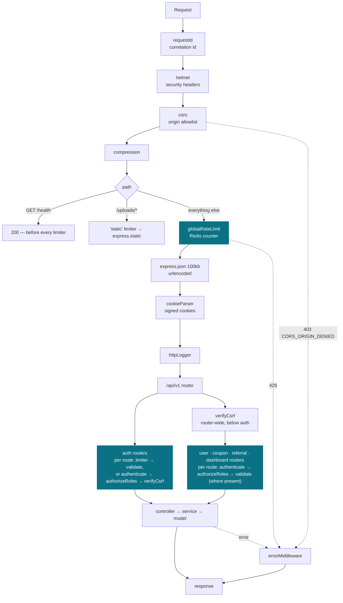

# Platform

> **Verified against the code on 2026-10-19.** Line numbers refer to the working tree.

How the server itself works — the internal machinery every module sits on. Business behaviour
lives in [../modules/](../modules/README.md); this section is the runtime.

| Document | Covers |
|---|---|
| [configuration.md](configuration.md) | env loading, fail-fast, what is config vs code vs data |
| [redis.md](redis.md) | what lives in Redis, the key map, TTLs, failure modes |
| [rate-limiting.md](rate-limiting.md) | the limiter, its algorithm, buckets and headers |
| [database.md](database.md) | MongoDB today, and the Prisma v7 target |
| [scaling.md](scaling.md) | the hot-path budget and how this scales horizontally |

---

## The life of a request

The order below is the order of `app.use` calls in `src/server.ts:32-104`.

Sources: `requestId` → `compression` at `server.ts:32-71`; `/health` at `server.ts:75-82`;
`/uploads` at `server.ts:87-91`; `globalRateLimit` at `server.ts:95`; body parsers, cookies and the
HTTP logger at `server.ts:97-100`; the API mount at `server.ts:102`; `errorMiddleware` at
`server.ts:104`. Inside the API router, auth is registered first and the router-wide `verifyCsrf`
comes after it (`src/routes/index.ts:12-21`). A typical auth route is
`src/modules/auth/routes/customer/auth.ts:14-27`; a typical module route is
`src/modules/user/routes/admin/managedUser.ts:14,23-29`.

Three things about this order are deliberate and easy to get wrong:

**`/health` answers before every limiter.** The global limiter is mounted on the app
(`server.ts:95`), not on the API router, so anything it should not count must be mounted above it.
A load balancer's health checks come from very few IPs and would burn the allowance during an
incident, which is exactly when health checks need to work (`server.ts:73-74`).

**The limiter runs before body parsing** but after CORS and helmet. `JSON.parse` of a large body is
synchronous work, and a limiter mounted after the parser could never prevent that cost
(`server.ts:93-95`). Preflights and security headers still behave during a flood.

**`/uploads` has its own counter** (bucket `static`, same numbers as the global one,
`server.ts:84-91`), so a page that renders 20 profile images does not spend 20 of the visitor's API
allowance.

A side effect of the order: a request the global limiter rejects never reaches `httpLogger`. The
limiter logs it (`src/middlewares/rateLimit.ts:127-133`), and `errorMiddleware` logs it again.

---

## What runs at boot

In order:

1. **Import time.** `src/config/env.ts` runs when `server.ts` imports it (`server.ts:10`). A missing
   `COOKIE_SECRET`, a missing `MONGO_URI` in production, or a number that is not a valid integer
   throws and stops the process ([configuration.md](configuration.md#fail-fast)). Importing the Redis
   client builds its URL, and a `REDIS_URL` db index that disagrees with `REDIS_DB` throws too
   (`src/utils/redisClient.ts:16-21`, `30-33`).
2. **`ALLOWED_ORIGINS`** must be non-empty in production, or the process exits (`server.ts:110-113`).
3. **Redis connects**, or the process exits (`server.ts:117-121`).
4. **MongoDB connects**; a failure is logged and the process exits (`server.ts:123`, `140-143`).
5. **Listen.** A listen error such as `EADDRINUSE` is logged and the process exits
   (`server.ts:125-130`).

Redis is not optional. Sessions, lockout counters, rate limits, OTP codes and password-reset
sessions all live there, so a server that boots without it looks healthy and rejects every login.
That is worse than not starting — see [redis.md](redis.md#failure-modes).

**Shutdown.** On `SIGINT` or `SIGTERM` the server stops accepting connections and waits for the
HTTP server to close, then disconnects MongoDB, then closes Redis, then exits 0. If any step throws,
it logs and exits 1 (`server.ts:146-163`). There is no forced timeout.

---

## Layers, and what each may touch

The rules are in [../standards/project-structure.md §4](../standards/project-structure.md) (one job
per layer) and §12 (cross-module imports). They are not repeated here.

**Today versus the rule:** the target chain is controller → service → `models/<X>/repo.ts`. Only
`modules/auth/models/Session/repo.ts` exists (it is Redis, not a database). Many legacy controllers
call Mongoose models directly — for example `src/modules/user/controllers/admin/role.ts:44` and the
`coupon`, `referral` and `dashboard` controllers. See [database.md](database.md).
