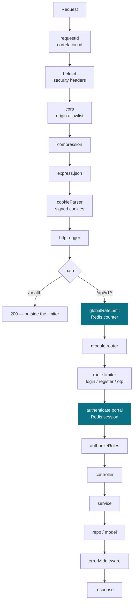

# Platform

How the server itself works — the internal machinery every module sits on. Business behaviour
lives in [../modules/](../modules/auth/README.md); this section is the runtime.

| Document | Covers |
|---|---|
| [configuration.md](configuration.md) | env loading, fail-fast, what is config vs code vs data |
| [redis.md](redis.md) | what lives in Redis, the key map, TTLs, failure modes |
| [rate-limiting.md](rate-limiting.md) | the limiter, its algorithm, buckets and headers |
| [database.md](database.md) | what stays durable, and the Prisma v7 migration plan |
| [scaling.md](scaling.md) | the hot-path budget and how this scales horizontally |

---

## The life of a request

Two things about this order are deliberate and easy to get wrong:

**The limiter sits on the API router, not the app.** `/health` must answer even when the limiter
would reject — a load balancer's checks come from very few IPs and would burn the allowance during
an incident, which is exactly when health checks need to work.

**The limiter runs before body parsing on the API path** but after CORS and helmet, so a flood does
not pay JSON-parse cost while preflights and security headers still behave.

---

## What runs at boot

`src/server.ts` in order: validate env (throws on a missing secret), connect Redis (**exits the
process on failure**), connect MongoDB, then listen.

Redis is not optional. Sessions, revocation counters, rate limits and OTP all live there, so a
server that boots without it looks healthy and rejects every login. That is worse than not starting
— see [redis.md](redis.md#failure-modes).

---

## Layers, and what each may touch

| Layer | May call | Must never |
|---|---|---|
| route | middleware, controller | contain logic |
| middleware | services, `redisKeys` | query a model directly |
| controller | services | touch the ORM, hold business rules |
| service | repos, other modules' facades | see `req` / `res` |
| repo / model | the database or `redisKeys` | hold business rules |

Enforced by review, and by the two rules in
[../standards/project-structure.md](../standards/project-structure.md).
