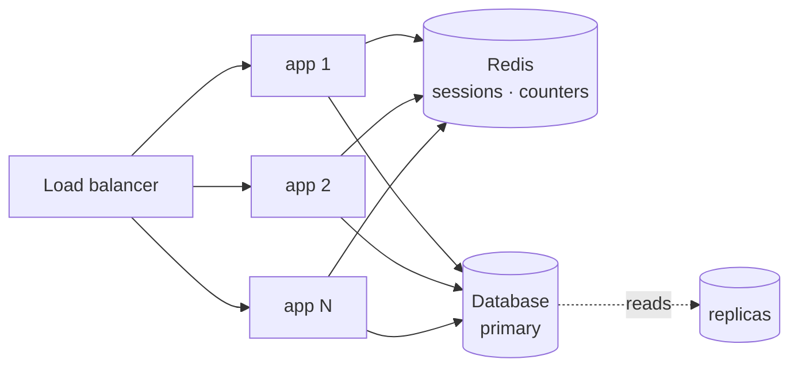

# Scaling

> **Verified against the code on 2026-10-19**, except where a line says "target". No load test has
> been run; nothing here is measured.

What this backend does to survive traffic, and where it breaks first.

---

## The one law

Work that grows with the size of the data must not happen inside a request. Everything below is a
consequence of that. The full rules: [../standards/performance-practices.md](../standards/performance-practices.md).

---

## The hot-path budget

An authenticated API request costs, before the handler runs:

| Step | Cost | Writes |
|---|---|---|
| global rate limiter | 1 Redis round trip — `INCR` + `EXPIRE NX` + `TTL` in one `MULTI` (`src/utils/redisKeys.ts:133-140`) | yes — the `INCR`, every request |
| session verify | 1 Redis round trip — `GET` + `TTL` in one `MULTI` (`src/modules/auth/models/Session/repo.ts:96-101`) | only when less than half the TTL remains, fire-and-forget ([redis.md](redis.md#what-authenticating-a-request-costs)) |
| user display fields | none — read from the session record (`src/modules/auth/middlewares/authenticate.ts:19-28`) | — |
| **Total** | **2 Redis round trips, no database call** | |

A route with its own bucket (login, register, OTP) adds one more round trip per identifier it
checks. Those routes are mostly not authenticated.

**No database call is the number that matters.** A database write on the hot path is the first
scaling wall: it contends on the primary, cannot be served by a replica, and grows the oplog for
data nobody reads. A database read on every request is the second.

---

## How it scales out

Sessions and counters are in Redis, not in process memory, so any instance can verify any session.

No sticky sessions and no in-process cache that has to be invalidated across nodes.

**One thing is still local: uploaded images.** They are written to `uploads/` on the instance's own
disk (`src/modules/user/helpers/image.ts:18-30`) and served from there (`src/server.ts:87-91`).
**Real world:** a user uploads a profile picture through app 1; the next page load goes to app 2,
which has no such file, and the image is a 404. Before running more than one instance, move uploads
to shared storage (object storage or a CDN) — the comment at `server.ts:86` says the same.

---

## Bounded everything

Unbounded growth is the failure that arrives quietly, months later.

| What | Bound | Without it |
|---|---|---|
| sessions per user | `SESSION_MAX_PER_USER` (10, `src/config/env.ts:192`) — oldest evicted after each login | a login loop grows the set forever |
| session payload | small record, no user document ([redis.md](redis.md#what-is-in-it)) | memory grows per session, batched reads slow down |
| every Redis key | a TTL ([redis.md](redis.md#key-map)) | keys accumulate permanently |
| list endpoints | page size capped — 100 in the user module (`src/modules/user/validators/index.ts:22-23`) | one request can read the whole collection |
| JSON / form body | 100 kb, parsed **after** the global limiter (`src/server.ts:95-98`) | an attacker gets synchronous `JSON.parse` time for free |
| uploaded file | 2 MB, held in memory (`src/modules/user/helpers/upload.ts:7`, `16-20`) | a large upload exhausts memory |

List endpoints paginate by offset (`skip`) today. Cursor pagination
([performance-practices §6](../standards/performance-practices.md)) is **target — not built**; a deep
page costs more the deeper it is.

---

## Where it breaks first

A ranking by reasoning, not by measurement:

1. **Local uploads** — the first thing that breaks when a second instance is added (above).
2. **Password hashing cost** — argon2id at m=19456 KiB (`env.ts:290`) is deliberate CPU and memory
   work on every login and password change. It runs on libuv's threadpool, not the event loop, so
   tune `UV_THREADPOOL_SIZE` to the core count before raising the cost.
3. **Redis as a single point** — sessions and limits both depend on it. A replica plus failover is
   the answer; the app already fails fast at boot and fails open on limits. Every Redis command the
   app sends names a single key, so none should fail on a Redis Cluster — not tested on one
   ([redis.md](redis.md#scaling-rules)).
4. **The database primary** for read-heavy endpoints — replicas, then caching, in that order.

---

## Known limits

Real, unfixed, and tracked:

- **`/uploads` is served without auth.** Anyone with a file's URL can fetch it. Every stored file is
  re-encoded to WebP by sharp first (`src/modules/user/helpers/image.ts:23-30`), so only images are
  ever served.
- **Offset pagination**, as above.

---

## Measure before claiming

Nothing here is "scalable" because a document says so. Read the query plan, watch event-loop lag,
load-test the endpoint, and optimise the bottleneck the numbers show — not the guessed one.
