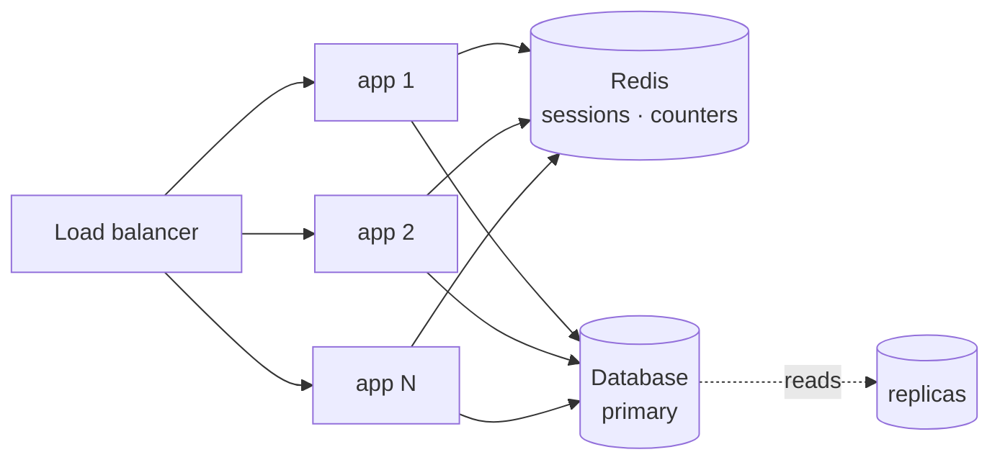

# Scaling

What this backend does to survive traffic, and where it breaks first.

---

## The one law

Work that grows with the size of the data must not happen inside a request. Everything below is a
consequence of that.

---

## The hot-path budget

An authenticated request costs, before the handler runs:

| Step | Cost |
|---|---|
| rate limiter | 1 pipelined Redis round trip |
| session verify | 1 Redis read |
| user display fields | 1 indexed Mongo read (temporary — see below) |
| **Total** | **2 network round trips, zero writes** |

**Zero writes is the number that matters.** The previous implementation performed two reads *and a
write* per authenticated request. A write on the hot path is the first scaling wall: it contends on
the primary, cannot be served by a replica, and grows the oplog for data nobody reads.

The one remaining Mongo read exists only to populate display fields (`email`, `firstName`,
`profileImage`) that the old `req.user` contract promised. It is marked in the code and disappears
when `/me` serves from the session — after which authentication touches **Redis only**.

---

## How it scales out

The app is **stateless**. Sessions are in Redis, not in memory, so any instance can serve any
request and instances can be added or killed freely.

Adding capacity is adding instances. No sticky sessions, no shared filesystem, no in-process cache
that has to be invalidated across nodes.

---

## Bounded everything

Unbounded growth is the failure that arrives quietly, months later.

| What | Bound | Without it |
|---|---|---|
| sessions per user | `SESSION_MAX_PER_USER` (10) | a login loop grows the set forever |
| session payload | small record, no user document | memory grows per session, batched reads slow down |
| every Redis key | a TTL | keys accumulate permanently |
| list endpoints | capped limit, cursor pagination | one request can read the whole table |
| request body | 100 kb app-wide, parsed AFTER the limiter | was 10 MB parsed before it — an event-loop stall an attacker got for free |

---

## Where it breaks first

Honest ranking of what gives way as traffic grows:

1. **The display-field Mongo read** in `authenticate` — one indexed read per request. Removing it
   makes the hot path Redis-only. (Lockout counters and `lastLoginAt` writes are already gone.)
2. **Password hashing cost** — argon2id at m=19456 is deliberate CPU work. It runs on libuv's
   threadpool, not the event loop, so tune `UV_THREADPOOL_SIZE` to core count before raising it.
3. **Redis as a single point** — sessions and limits both depend on it. A replica plus failover is
   the answer; the app already fails fast at boot and fails open on limits.
4. **The database primary** for read-heavy endpoints — replicas, then caching, in that order.

---

## Known limits

Real, unfixed, and tracked:

- **`/uploads` served statically** with no auth and no content-type enforcement.
- **`@utils/clientIp` trusts spoofable headers**, and the logger and error middleware use it — so
  logged IPs are attacker-controlled.

---

## Measure before claiming

Nothing here is "scalable" because a document says so. Read the query plan, watch event-loop lag,
load-test the endpoint, and optimise the bottleneck the numbers show — not the guessed one.
